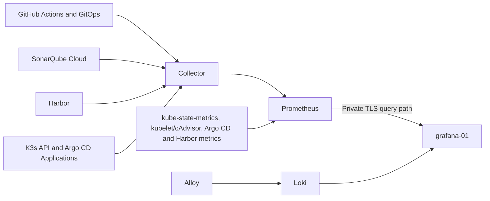

# Lantern DevOps KPIs

Four dashboards for the existing `grafana-01` instance cover development and code quality, deployments and container security, Kubernetes and microservice health, and service detail. The GitOps changes introduce a Prometheus data source and read-only collection for the seven services in [the service catalogue](collector/services.json). The Grafana role reuses the Kubernetes Loki datasource already present on the VM.

## Audit

| Component | Evidence checked | Phase 1 |
| --- | --- | --- |
| Grafana and Loki | The infrastructure inventory from 26 November 2026 records Grafana running on `grafana-01` and three Loki hosts. The TLS runbook records existing Grafana datasource use. The actual datasource UIDs, Grafana version and existing dashboards could not be inspected. | Provision four dashboards and one Prometheus datasource on the existing host. Select the existing Kubernetes Loki datasource in the logs dashboards. |
| Alloy | The GitOps Application tracks the documented K3s Helm DaemonSet in `monitoring`. Its River config still pushes to `http://192.168.0.15:3100`. The host-side TLS notes describe HTTPS on a different Loki endpoint and Ansible management from `/lantern/ansible`. The live cluster-to-Loki protocol and aliases are unverified. | Reuse the existing Alloy labels `job`, `namespace`, `pod` and `container`. Verify the working Loki datasource on Grafana before choosing it. |
| Zabbix | The November inventory records running PostgreSQL, server, frontend and host agents. | Reuse existing host monitoring. Kubernetes node readiness and scrape health are included for workload diagnosis. |
| Prometheus and kube-state-metrics | No installation, Operator resources or reusable exporter were found in the GitOps checkout or VM inventory. The chart enables Kubernetes state and kubelet/cAdvisor metrics. | Confirm the live inventory before installing. Reuse a suitable existing Prometheus and kube-state-metrics if an operator finds them. |
| Argo CD | The repo pins its chart to `10.9.2`, renders the application controller on metrics port 8082 and declares the seven applications via ApplicationSet. The current child Argo CD application declares automated self-heal and pruning. A read-only call to the private endpoint failed to connect from this workspace. | Add a monitoring-only ClusterIP Service and ServiceMonitor for the controller and read scoped Application status. |
| Harbor | The pinned chart renders `http-metrics` ports for exporter, core, registry and job service. Its values enable metrics and disable the chart-owned ServiceMonitor. The AppProject deny window and Secret ignore rules protect credential-preserving adoption. The November admission report records registry scanning, signed-image pull checks and Argo CD status at the time of that report. | Scrape the existing ports with a monitoring-owned ServiceMonitor and read the artifacts API. Harbor chart values and adoption policy are outside this change. |
| GitHub and delivery | The organization API lists ten repositories. The checked-out service repositories have CI, release and CD workflows. GitHub confirms platform `main` is protected and [PR #85](https://github.com/ProjectLanternDI3P1P2/platform-gitops/pull/85) merged on 26 November 2026 at 15:36 Paris time. The current promotion automation opens a PR and merges through the authorized service account after validation. The November workflows and a sampled Combat release run expose build/publish, scan gate, Cosign signing, attestation and verification steps. | Poll CI and release jobs via the read-only REST API and read the GitOps image declaration with its promotion commit metadata. |
| SonarQube Cloud | All five backends configure SonarScanner for .NET with coverage in their Sonar workflows. The Combat measures API responded with the requested coverage, debt, duplication and issue measures. Neither deployed frontend has a SonarQube configuration in its checkout. | Collect configured projects and display missing frontend quality data as unavailable. |
| Infrastructure as code | GitHub lists `platform-gitops` as the only infrastructure repository visible to this session. Host logging documentation names an external Ansible working tree at `/lantern/ansible`, absent from the workspace. Its remote, Grafana role and network/firewall configuration are unverified. | Keep the tested Grafana role alongside the versioned dashboard files so the VM playbook can consume the reviewed checkout. |

Audit references are the [VM inventory](../../_docs/technical/inventaire_services_vm.md), [Loki TLS notes](../../_docs/technical/hiffrement-tls-flux-logs.md), [Alloy configuration](../alloy/values.yaml), [image admission verification](../../_docs/technical/image-admission-verification-2026-11-27.md), [application delivery](../../_docs/technical/application-delivery.md) and [promotion workflow](../../.github/workflows/promote-image.yaml).

## Architecture and data



`service` is the Argo Application and Kubernetes namespace. The catalogue maps each service to its repository, Deployment, container, workflow filenames and Sonar project. Five backend squad assignments come from the GitOps CODEOWNERS file. Both frontends are `unassigned` pending an authoritative mapping. Update the catalogue and relevant RBAC, scrape filters and dashboard queries together when adding a service. The collector exposes cached snapshots every five minutes, and Prometheus scrapes every 30 seconds.

- **Development & Code Quality.** CI rates use observed completed attempts with success, failure, timeout or startup failure. Canceled, neutral and skipped runs are excluded. Jobs provide duration from run start to last completion and identify named build and test failures. Each poll reads up to 50 runs per workflow, and only the current attempt for a rerun is fetched. Points observed before a rerun remain in Prometheus until retention expires. The oldest observed event and source availability help identify partial windows. Sonar time series begin at first collection and describe the default branch.
- **Deployments & Container Security.** Latest publication means the newest tagged image by artifact push time in the newest 50 Harbor results. Latest release means the highest stable version in that window. The latest **observed validated release** requires a successful Harbor scan with zero critical findings and successful build/publish, scan gate, Cosign verification, provenance and published-digest checks in the job data. It ties the tag, digest and source commit to a matching promotion commit or to an immutable Harbor tag with a matching OCI source SHA. Conflicting OCI metadata prevents validation. The collector records the workflow’s verification evidence and any Harbor accessories it can see. It performs no independent cryptographic verification.
- **Deployment proof.** The runtime view follows Deployment → ReplicaSet → Pod ownership and reports the actual image and raw `imageID` of each running application container. Comparisons require a registry-qualified manifest digest for every observed running container. Naked runtime IDs can be image config IDs and leave digest comparison unavailable. GitOps digest and source commit come from the image declaration and matching promotion commit metadata. Harbor metadata can provide the same trace for a running digest. Confirmation requires the latest observed validated digest in GitOps and all current replicas, a complete rollout, Ready pods, and Argo CD Synced/Healthy. Argo history records successful syncs. The healthy deployment panel uses a saved observation with digest and readiness evidence. Unsupported multi-architecture index/child comparisons require explicit registry and runtime evidence.
- **Kubernetes & Microservices Health.** Deployment replicas, ready pods, restarts, CrashLoopBackOff, CPU and memory working set, requests and limits come from kube-state-metrics and kubelet/cAdvisor. The dashboard uses the seven service namespaces and application container names. Loki panels match severity tokens in log text, so their counts can include incidental mentions. Select the Kubernetes Loki datasource, which can differ from the VM logs datasource.
- **Service Detail.** Choose one service to see its commits and pipeline, quality, image trace, Argo state, replicas, resource use and recent logs. Links open the GitHub repo, Sonar project when configured, Harbor API repository or artifact, Argo application and Loki Explore. Use the shared dashboard dropdown for navigation.

Blank fields or missing rows mean the upstream evidence is unavailable for that panel or time range. `lantern_source_available = 0` reports a disabled or failed source. An image scan with an explicit successful severity summary can report zero counts. A scan that is missing, queued or failed yields no vulnerability counts.

## Installation

1. From a workstation with cluster access, inventory Prometheus, ServiceMonitors, kube-state-metrics and the `monitoring` namespace. Confirm whether the Helm CRDs are already managed. If a suitable Prometheus exists, adapt the monitors and collector ingress policy to its selectors and use its datasource endpoint. If only the CRDs already exist, agree on ownership before setting `crds.enabled: false` in the values. Check available Longhorn capacity and the `longhorn-stateful` StorageClass. Review the new Applications and their rendered diffs before syncing.
2. After PR review and merge, reconcile the platform AppProjects and parent Application using the existing bootstrap workflow. Verify `lantern-observability-k3s` exists and that the platform parent has registered both new children. With no existing suitable Prometheus, manually sync `devops-prometheus` first. It uses chart `92.10.0`, server-side apply for CRDs, a 20 GiB PVC, and retention capped at 30 days or 15 GB. Confirm CRDs are established and Prometheus is ready before the next sync. The chart uses its scoped Prometheus ServiceAccount token for kubelet scraping and verifies K3s serving TLS against the namespace root CA. Keep the token Secret protected by normal Kubernetes RBAC and encryption controls.
3. Use the existing secure secret provisioning process to create `monitoring/lantern-kpi-api`. The table below lists its keys. The collector re-reads the mounted files while polling. Provide HTTPS egress from the collector to GitHub, SonarQube Cloud and the approved Harbor endpoint. Verify the pinned collector image can be pulled under the cluster's existing image policy. Manually sync `devops-kpis` with pruning disabled. Verify the two ServiceMonitors and collector target are healthy.
4. Have the network owner provision a private HTTPS query endpoint for `lantern-kpi-prometheus.monitoring.svc:9090` through their existing private proxy and firewall IaC. Restrict access to `grafana-01`, validate the TLS chain and allow Grafana's GET and POST Prometheus query endpoints. The cluster service is ClusterIP. The Grafana role takes the approved endpoint as `lantern_kpi_prometheus_url`, with optional Vault-managed `lantern_kpi_prometheus_user` and `lantern_kpi_prometheus_password`. Use permitted Grafana folder and datasource access controls.
5. Import the Ansible role from this checkout into the host playbook, run a check against `grafana-01`, then apply during the normal Grafana maintenance window. Datasource and provider changes notify a Grafana restart. Dashboard-only updates are read by file polling. Set the Kubernetes Loki selector on the health and service-detail dashboards where multiple Loki datasources exist.

Example Ansible playbook entry with a checked-out bundle on the controller:

```yaml
- hosts: grafana-01
  become: true
  roles:
    - role: /path/to/platform-gitops/observability/devops-kpis/grafana/ansible
```

| Secret key | Access required |
| --- | --- |
| `github-token` | Read-only fine-grained token on all seven service repositories and `platform-gitops`. Actions read on service repos and Contents read on all selected repos. |
| `sonar-token` | SonarQube Cloud service account or approved token with Browse access to the five configured projects. |
| `harbor-user`, `harbor-token` | Read-only Harbor project principal with artifact and scan visibility in `lantern`. |
| `harbor-ca.crt` | Trusted CA PEM for the private Harbor endpoint and its configured SAN. |

## Validation and troubleshooting

Render the collector and monitoring chart locally. Check generated dashboard JSON and run the collector tests. The repository's Validate GitOps workflow runs the same checks with the pinned chart.

```bash
kubectl kustomize observability/devops-kpis/collector
helm repo add prometheus-community https://prometheus-community.github.io/helm-charts
helm template lantern-kpi prometheus-community/kube-prometheus-stack \
  --version 92.10.0 --namespace monitoring --include-crds \
  -f observability/devops-kpis/prometheus/values.yaml
python3 -B observability/devops-kpis/grafana/generate.py --check
python3 -B -m unittest discover -s observability/devops-kpis/collector
```

- In Prometheus Targets, inspect kubelet, kube-state-metrics, Argo CD, Harbor and the collector. If the kubelet target has an X.509 error, confirm that K3s node scrape addresses are in the certificates’ SANs and that `kube-root-ca.crt` contains the issuing CA. For missing Harbor targets, compare the live Service names and ports with the rendered 1.19.2 chart.
- From `grafana-01`, test the private Prometheus endpoint with TLS and the approved credentials. In Grafana Explore query `kube_deployment_spec_replicas{namespace="combat"}`, `argocd_app_info{name="combat"}`, `up{job="harbor-exporter"}`, and `lantern_source_available{service="combat"}`. On Loki confirm `{job="kubernetes-pods",namespace="combat"}` returns the expected stream.
- Check one known successful CI job and one failed job against GitHub. Compare Sonar coverage and gate with the project page. Inspect all running pod IDs of one recent release and compare them with the declared digest and Harbor. Include a rollout with a stale or missing digest and verify the dashboard does not confirm delivery.
- Check `lantern_collector_snapshot_timestamp_seconds` and the collector pod's logs when data is missing. Errors omit upstream bodies and credentials. A GitHub 403 can indicate rate limits or missing Actions/Contents permissions. A Harbor auth failure can affect image evidence while native metrics still scrape successfully. Failed scan results and the release verification stage are visible in their respective panels.
- Keep provisioning in Git. To roll back, revert the reviewed changes and use the normal manual Argo CD/Ansible workflow. Review retention of Prometheus PVCs and shared CRD ownership before any uninstall. Removing dashboard files from the managed Grafana directory allows its dedicated provider to remove those dashboards.

Local validation included all Kustomize overlays, the pinned Prometheus, Harbor and Argo CD chart renders, generated dashboard consistency, all PromQL expressions with substituted Grafana variables, the existing migration/promotion test suite, collector regression tests, and an isolated Grafana Ansible role check. Production scrape authentication, network connectivity, Grafana/Loki provisioning and real Kubernetes image IDs still require operator access.

## Apache DevLake

Defer DevLake until the team needs historical DORA and PR analysis. Its GitHub integration can collect Actions, commits, PR and review events. The published SonarQube plugin compatibility matrix lists SonarQube Server v8/v9, so test SonarQube Cloud against a pinned DevLake release before enabling that plugin. The published list has no native Argo CD source. Use a deployment webhook driven by a reconciled Kubernetes rollout and correlated with Argo CD and GitOps. [Supported sources](https://devlake.apache.org/docs/Overview/SupportedDataSources/) · [Deployment webhook](https://devlake.apache.org/docs/Plugins/webhook/).

Keep a durable event stream keyed by environment, service, GitOps revision and manifest digest. Emit a successful production event when the expected digest is running throughout a healthy rollout and Argo CD reports Synced and Healthy. Capture failed/rolled-back rollout events and link incidents to deployments through explicit IDs where possible. Preserve the first observed healthy timestamp and the source commit. Pilot these event contracts with one service, validate deduplication and calculations, then consider deployment of DevLake and its database.

| Metric | Events and calculation |
| --- | --- |
| Deployment frequency | Count distinct successful production deployments in each period from verified rollout events. |
| Lead time for changes | Median time from each shipped source commit’s Git timestamp to its first successful production deployment. Map squash merges and releases through GitHub PR commits and the verified release SHA. |
| Change failure rate | Production deployments requiring remediation, such as a linked incident, rollback or hotfix, divided by production deployments in the reporting period. Attribute failures to the triggering deployment and publish the attribution window. |
| Failed deployment recovery time | Median elapsed time from failure or linked incident onset to the healthy recovery rollout or incident restoration, including rollbacks. |
| PR cycle time | Time from the first PR commit to the first successful production rollout that includes it. Treat unshipped PRs as pending. |
| PR review time | Time from the first qualifying review/comment to merge, following DevLake's calculation. PRs without a qualifying review have no review duration. |

See [DevLake DORA definitions](https://devlake.apache.org/docs/DORA/) and [PR metrics](https://devlake.apache.org/docs/Metrics/) for transformation rules. Keep the production environment mapping explicit before using these reports across squads.
