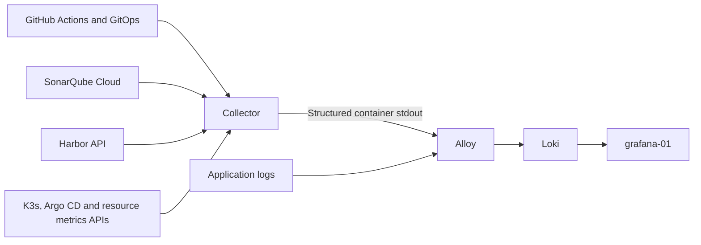

# Lantern DevOps KPIs

The four Grafana dashboards cover development and quality, deployments and container security, Kubernetes health, and service detail. They all use the existing Kubernetes Loki datasource on `grafana-01`. The read-only collector writes structured observations to container stdout. The existing Alloy DaemonSet forwards those observations with the Kubernetes logs.

## Audit

| Component | Evidence checked | Implementation |
| --- | --- | --- |
| Grafana, Loki and Alloy | The infrastructure inventory records Grafana, three Loki hosts and Loki datasources. The GitOps Alloy Application tracks the K3s Helm DaemonSet in `monitoring`. Its River configuration pushes to `http://192.168.0.15:3100`, while the TLS runbook and VM inventory describe HTTPS on the Kubernetes Loki server. The effective live protocol, Grafana version and datasource UID remain unverified. | Reuse the existing Alloy labels and Kubernetes Loki datasource. The collector uses stdout and requires the live Alloy delivery pipeline to be working. |
| Kubernetes | The repository declares the seven services through the Argo CD ApplicationSet and Kustomize overlays. The private Argo CD endpoint was unreachable from this workspace. K3s ships metrics-server, which can be disabled. Live availability of the resource metrics API is unverified. | Read Deployments, ReplicaSets, Pods and the existing metrics API within the service namespaces. CPU and memory usage appear when metrics-server returns the expected pod samples. |
| Argo CD | Its chart is pinned to `10.9.2`. The Application objects carry sync, health, operation and history data. | Read the seven Application objects with scoped RBAC. Record failed syncs observed in Application state. |
| Harbor | The pinned chart has metrics enabled and its chart-owned ServiceMonitor disabled. The AppProject sync window and Secret ignore rules protect Harbor credential preservation. The November admission report records scans and signed-image pull checks. | Read artifact metadata and scan results through the Harbor API. The chart and adoption controls remain in their existing ownership. |
| GitHub and delivery | GitHub lists ten repositories, confirms protected platform `main` and records [PR #85](https://github.com/ProjectLanternDI3P1P2/platform-gitops/pull/85) as merged on 26 November 2026 at 15:36 Paris time. Promotion opens a GitOps PR. The checked-out workflows and a sampled Combat release expose build, publish, scan, signing, provenance and digest verification steps. | Read CI and release workflow jobs, GitOps image declarations and associated promotion metadata using the REST API. |
| SonarQube Cloud | All five backends configure SonarScanner for .NET and coverage. The Combat measures API responded with the requested metrics. The two frontend checkouts have no SonarQube configuration. | Collect quality measures and gates for the configured projects. Frontend quality data remains unavailable until projects are configured. |
| Infrastructure as code | `platform-gitops` is the only infrastructure repository visible to this session. Host logging documentation names `/lantern/ansible`, which was unavailable. | Deliver the dashboard provisioning role with the GitOps repository for use by the Grafana host playbook. |
| Zabbix | The VM inventory records Zabbix server, frontend, PostgreSQL and host agents. | Continue relying on Zabbix for host and infrastructure supervision. |

See the [VM inventory](../../_docs/technical/inventaire_services_vm.md), [Loki TLS notes](../../_docs/technical/hiffrement-tls-flux-logs.md), [Alloy configuration](../alloy/values.yaml), [image admission report](../../_docs/technical/image-admission-verification-2026-11-27.md), [K3s packaged component documentation](https://docs.k3s.io/installation/packaged-components) and [application delivery guide](../../_docs/technical/application-delivery.md).

## Architecture and data



The collector polls every five minutes. It writes dashboard records to stdout prefixed by `LANTERN_KPI`. LogQL extracts fields at query time. Service IDs, digests and workflow IDs remain in the JSON payload to keep Loki stream cardinality bounded. Current tables use the last complete snapshot of each service at the end of the selected time range, with a 15-minute freshness window. An empty result indicates that evidence is unavailable in the selected window.

The [service catalogue](collector/services.json) maps the Argo CD Application and Kubernetes namespace to the repository, Deployment, container, workflows and Sonar project. Backend squad assignments come from `CODEOWNERS`. The frontends remain `unassigned` pending a confirmed mapping. When adding a service, update the catalogue, RBAC, AppProject destinations and dashboard log selector as applicable.

- **Development & Code Quality.** Rates count distinct observed GitHub workflow attempts with success, failure, timeout or startup failure. The collector polls up to 50 recent runs per workflow and reads the latest known attempt’s jobs. Duration runs from workflow start to latest job completion. It identifies named build and test failures. Period summaries use the GitHub completion/update time within the selected range and require that Loki received the records. The daily duration chart uses Loki observation time. At first collection, recent GitHub runs can appear together on that chart. Sonar trends begin when Loki first receives the measures.
- **Deployments & Container Security.** Latest publication is the most recently pushed tagged image among the 50 results sampled from Harbor. Latest release is the highest stable version in that window. The latest observed validated release requires a successful Harbor scan with zero critical findings and successful build, publication, scan gate, signing, attestation and verification workflow steps. The association between the tag, digest and source SHA comes from a matching GitOps promotion commit or an immutable Harbor tag with matching OCI source metadata. Harbor accessories show registry-reported signature and attestation metadata. The collector relies on the release workflow for cryptographic verification.
- **Deployment proof.** The collector follows Deployment → ReplicaSet → Pod ownership and records the observed container image and raw Kubernetes `imageID`. A comparison requires an unambiguous registry-qualified digest for every running application container. Confirmation requires matching validated, GitOps and runtime digests, a complete rollout, Ready pods, and Argo CD Synced/Healthy. The successful sync date comes from Argo CD history. The healthy deployment date requires a matching observed rollout. The count of failed syncs covers distinct failed operations observed in Application status during polling. Short-lived failures between polls can be missed.
- **Kubernetes & Microservices Health.** Polls supply replicas, pod readiness, current restart counts, CrashLoopBackOff and rollout status. CPU and memory come from `metrics.k8s.io` when samples exist for all active service pods. Resource requests and limits describe the configured application container multiplied by desired replicas. Loki panels show application error and warning lines and link to Explore.
- **Service Detail.** Shows the selected service’s commit, CI, quality, image trace, Argo CD status, replicas, resource use, recent logs and source links.

## Rollout

1. Confirm the existing Kubernetes Loki datasource on `grafana-01` and check that `{job="kubernetes-pods"}` returns live logs. If Alloy and Loki disagree about TLS, follow the existing logging runbook with the infrastructure owner.
2. Confirm the `monitoring` namespace and the resource metrics API. From an authorized cluster workstation, use `kubectl get apiservice v1beta1.metrics.k8s.io` and `kubectl top pods -n combat`. If the API is unavailable, the other KPI panels can still operate while CPU and memory usage stay unavailable.
3. After review and merge, reconcile the platform AppProjects and parent Application using the ordinary GitOps bootstrap. Verify `lantern-observability-k3s` is present. Use the existing secret provisioning process to create `monitoring/lantern-kpi-api`. Ensure HTTPS egress to GitHub, SonarQube Cloud and the approved Harbor endpoint. Verify the pinned Python image can be pulled under existing admission policy and manually sync `devops-kpis`.
4. Include the Grafana Ansible role in the host playbook, check it against `grafana-01`, then apply it during the normal maintenance window. A change to the dashboard provider notifies a Grafana restart. Updated dashboard JSON is picked up by file polling. Select the Kubernetes Loki datasource on each dashboard.

```yaml
- hosts: grafana-01
  become: true
  roles:
    - role: /path/to/platform-gitops/observability/devops-kpis/grafana/ansible
```

| Secret key | Access required |
| --- | --- |
| `github-token` | Fine-grained Actions read on the seven service repositories and Contents read on those repositories and `platform-gitops`. |
| `sonar-token` | Browse access to the five configured SonarQube Cloud projects. |
| `harbor-user`, `harbor-token` | Read-only Harbor project principal with artifact and scan visibility in `lantern`. |
| `harbor-ca.crt` | Trusted CA PEM for the private Harbor endpoint. |

## Validation and troubleshooting

```bash
kubectl kustomize observability/devops-kpis/collector
python3 -B observability/devops-kpis/grafana/generate.py --check
python3 -B -m unittest discover -s observability/devops-kpis/collector
```

- In Grafana Explore, select Kubernetes Loki and query `{job="kubernetes-pods",namespace="monitoring",container="lantern-kpi-collector"} |= "LANTERN_KPI "`. If there are no results, check the collector pod’s stdout and Alloy delivery.
- Review the **Source availability** panels for API failures. A GitHub 403 can mean missing read permissions or rate limiting. If workload state is present but resource usage is empty, check `metrics.k8s.io` availability, RBAC and sample coverage for all active pods.
- Compare a known release with its GitOps declaration and current pod image IDs. A runtime reporting only an image configuration SHA leaves the manifest digest comparison unavailable. Compare Sonar and GitHub panels with the respective upstream pages.
- Loki controls KPI retention. Compare current ingestion and query latency with the baseline during rollout. Keep the dashboard timezone and time range consistent when comparing with a source. Review the existing Loki retention before using the dashboards for longer historical reports.
- Roll back by reverting the reviewed changes and reconciling Argo CD and the Grafana role through the existing workflow. Dashboard files are tracked by the dedicated provider. Review the provider’s deletion behavior before removing the file directory.

## Apache DevLake

Defer DevLake until historical DORA and PR analysis is needed. GitHub integration can collect Actions, commits, PRs and reviews. DevLake's published compatibility matrix lists SonarQube Server v8/v9. Test SonarQube Cloud against a pinned release before enabling that integration. Use the deployment webhook for verified Kubernetes rollouts correlated with Argo CD and GitOps. [Supported sources](https://devlake.apache.org/docs/Overview/SupportedDataSources/) · [Deployment webhook](https://devlake.apache.org/docs/Plugins/webhook/)

| Metric | Proposed source events and calculation |
| --- | --- |
| Deployment frequency | Distinct successful production rollouts per period, deduplicated by service, GitOps revision and digest. |
| Lead time for changes | Median time from each shipped source commit to its first matching healthy production rollout. |
| Change failure rate | Production deployments requiring linked remediation divided by production deployments in the same reporting period. |
| Failed deployment recovery time | Median time from a deployment failure or linked incident to the verified healthy recovery rollout. |
| PR cycle time | Time from the first PR commit to its first healthy production rollout. |
| PR review time | Time from a qualifying review or comment to merge, according to the project’s review rule. |
